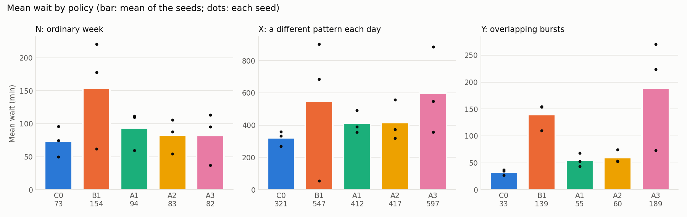
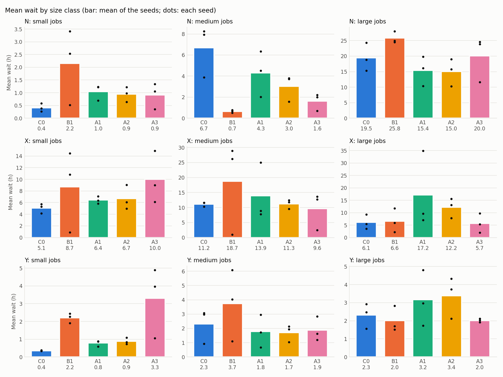
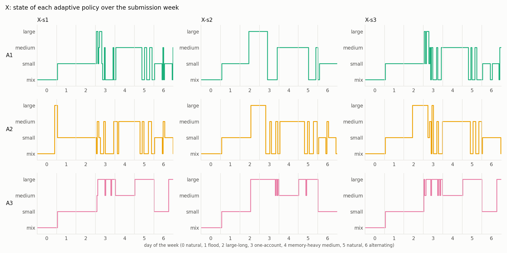
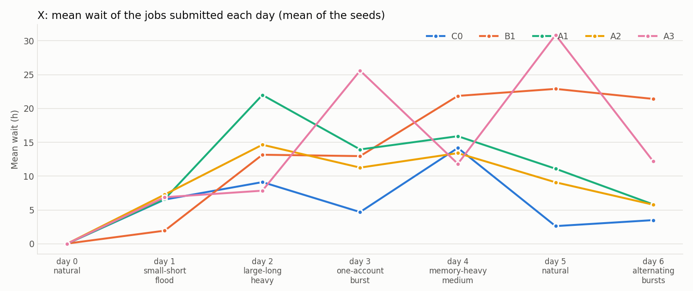
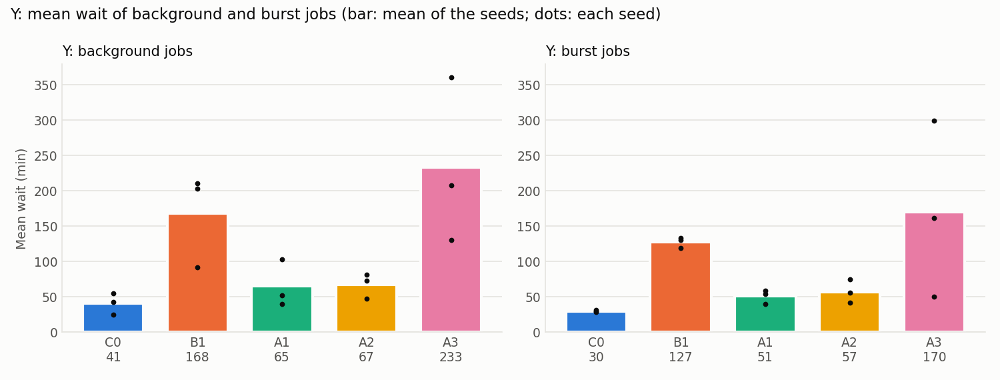

# REPORT — Adaptive Slurm priority weights (ver_0.3)

This report answers the research question of [SPEC.md](SPEC.md) §1 with the Step 6
evaluation of SPEC §8. All paths are relative to `ver_0.3/`.

## Summary

> Can switching priority weights based on the live cluster state adapt to changing workloads
> and provide better overall service than a fixed weight setting: the neutral configuration
> (C0) or a typical site setting (B1)?

**No.** On 45 one-week simulations (three scenarios × three seeds × five policies), none of
the three adaptive policies beat the neutral fixed setting C0:

| Mean wait (min), mean of 3 seeds | C0 neutral | B1 typical site | A1 | A2 | A3 |
|---|---|---|---|---|---|
| `N` ordinary week | **73** | 154 | 94 | 83 | 82 |
| `X` a different pattern each day | **321** | 547 | 412 | 417 | 597 |
| `Y` overlapping bursts | **33** | 139 | 55 | 60 | 189 |

- **The mechanism works.** The controller switches weights inside the running simulator, and
  every switch re-ranks the waiting queue within 2 simulated seconds.
- **The policies do what they are built to do,** within limits:
  - While medium jobs are favored, they wait 55–91% less on `N` and about 80% less on `Y`.
  - While large jobs are favored, they wait 30–83% less on `N`.
- **That is not enough.** About 90% of the jobs are small. C0 already starts short jobs first,
  so favoring any other class delays the majority. Favoring small jobs never helps them:
  that state only starts once a small backlog has built up.
- **The verdict.** In 26 of 27 paired comparisons the adaptive policy has the longer mean wait.
  The one win (A3 on `N-s2`, −25%) more than doubles small jobs' waits.

## 1. What was built

| Part | What | Where |
|---|---|---|
| Cluster | 16 nodes × 32 cores × 128 GB, one partition, Slurm's backfill scheduler, priority recomputed every minute, in the UB Slurm Simulator | SPEC §2, `sim/` |
| Workloads | One-week scenarios cut from the real trace and thinned to 95% of the cluster's memory: `K` (calibration), `N` (ordinary week), `X` (a different pattern each day), `Y` (overlapping bursts), 3 seeds each | SPEC §3, `workloads/`, `config/scenarios.yaml` |
| Job classes | 9 classes: size small / medium / large × time limit short / medium / long | SPEC §4, `config/classes.yaml` |
| Configurations | C0 neutral; C1 favor large; C2 favor small; C3 favor medium. A size QOS puts the favored class first, then shortest time limit, then fair share. B1 is SchedMD's multifactor example, fair share first | SPEC §5, §8.2, `config/weights.yaml`, `config/priority/` |
| Trigger | Every 10 simulated minutes, each class's share of the waiting queue as a percentile of its range in `K`. Enter a class state at P80, leave below P60, 2-tick persistence, minimum stay | SPEC §6, `controller/policy.py`, `config/triggers*.yaml` |
| Mechanism | A patch to the simulator adds a policy tick that writes a snapshot, runs the Python controller, and applies the chosen configuration in place | SPEC §7, `sim/patches/policy_hook.patch` |

The adaptive policies:
- **A1:** the Phase 2 trigger on the waiting queue, with a 60-minute minimum stay.
- **A2:** A1 with 120-minute stays in the small and medium states.
- **A3:** the same trigger on arrivals in the last hour instead of the waiting queue.

All three start in C0, and every parameter was fixed on `K` before evaluation.

## 2. How it was evaluated

- **Runs.** 5 policies × 9 workloads (`N`, `X`, `Y` × seeds 1–3) = 45 one-week runs. Each run
  continues until the queue has drained.
- **Noise runs.** C0 and A1 ran three times on seed 1 of each scenario: 12 more runs.
- **Checks.** Every run passed `sim/check_run.py`: each job ran exactly once with its own CPUs,
  memory, limit, user, account and QOS, and for its trace run time. Adaptive runs also passed
  `controller/summarize.py`: every tick logged by both the simulator and the controller, every
  switch applied, replay exact.
- **Primary metric:** mean wait. Also measured: median and 95th-percentile wait, bounded
  slowdown, wait by size class and job class, utilization, node imbalance, and Jain's fairness
  index over accounts (SPEC §8.5).
- **The bar, `S*`:** the better of C0 and B1 averaged over the nine workloads. It is C0, at
  142 min against B1's 280.
- **Effective.** An adaptive policy is effective on a scenario only if, on all three seeds:
  - it beats `S*` by more than the noise band; and
  - no size class waits more than 25% longer, utilization drops by no more than 1 point, and
    Jain's index drops by no more than 0.05.
- **Answer rule:** yes if it is effective on both `X` and `Y` and no worse on `N`; partly if
  effective on one of them; no otherwise (SPEC §8.6).

## 3. Results

### 3.1 Mean wait



| Mean wait (min) | C0 | B1 | A1 | A2 | A3 |
|---|---|---|---|---|---|
| N-s1 | **75** | 221 | 111 | 88 | 95 |
| N-s2 | 50 | 62 | 60 | 54 | **37** |
| N-s3 | **96** | 178 | 110 | 105 | 113 |
| X-s1 | **333** | 686 | 357 | 374 | 356 |
| X-s2 | 269 | **54** | 490 | 320 | 548 |
| X-s3 | **359** | 902 | 390 | 556 | 886 |
| Y-s1 | **35** | 153 | 44 | 74 | 224 |
| Y-s2 | **27** | 110 | 53 | 53 | 271 |
| Y-s3 | **37** | 155 | 68 | 53 | 73 |

**Noise.** Three runs of the same workload and policy differ by up to 22% on `N`, 31% on `X`
and 24% on `Y` (relative range of the primary metric over the C0 and A1 repeat sets). In all
six repeat sets the third run, made in one later window, came out higher than the other two;
how many runs shared the host does not explain it (§5).

### 3.2 By size class



| Mean of 3 seeds | C0 | B1 | A1 | A2 | A3 |
|---|---|---|---|---|---|
| `N` small (min) | **25** | 129 | 63 | 57 | 55 |
| `N` medium (h) | 6.7 | **0.7** | 4.3 | 3.0 | 1.6 |
| `N` large (h) | 19.5 | 25.8 | 15.4 | **15.0** | 20.0 |
| `X` small (min) | **304** | 523 | 386 | 401 | 600 |
| `X` medium (h) | 11.2 | 18.7 | 13.9 | 11.3 | **9.6** |
| `X` large (h) | 6.1 | 6.6 | 17.2 | 12.2 | **5.7** |
| `Y` small (min) | **21** | 132 | 47 | 53 | 198 |
| `Y` medium (h) | 2.3 | 3.7 | 1.8 | **1.7** | 1.9 |
| `Y` large (h) | 2.3 | **2.0** | 3.2 | 3.4 | 2.0 |

On `N` the adaptive policies cut medium and large waits, but small jobs wait more than twice
as long. Small jobs are 89–95% of the jobs in every workload, so the mean follows them.

### 3.3 Other measures

| Mean of 3 seeds | C0 | B1 | A1 | A2 | A3 |
|---|---|---|---|---|---|
| `N` 95th-pct wait (h) | **5.7** | 8.9 | 8.3 | 6.9 | 7.0 |
| `N` bounded slowdown | 3.94 | **3.00** | 3.85 | 3.15 | 3.35 |
| `N` Jain's index | 0.12 | **0.51** | 0.18 | 0.20 | 0.28 |
| `X` 95th-pct wait (h) | **22.3** | 75.4 | 23.8 | 24.3 | 32.2 |
| `X` bounded slowdown | **26.7** | 26.9 | 32.4 | 33.6 | 45.3 |
| `X` Jain's index | 0.23 | 0.15 | 0.28 | 0.29 | **0.41** |
| `Y` 95th-pct wait (h) | **2.8** | 18.3 | 4.4 | 4.9 | 13.6 |
| `Y` bounded slowdown | **2.37** | 6.57 | 4.13 | 4.64 | 13.22 |
| `Y` Jain's index | 0.26 | 0.20 | 0.35 | 0.40 | **0.44** |
| Utilization `N` / `X` / `Y` | 0.76 / 0.64 / 0.71 | 0.77 / 0.59 / 0.69 | 0.75 / 0.57 / 0.70 | 0.75 / 0.57 / 0.71 | 0.75 / 0.59 / 0.68 |

- **Bounded slowdown on `N`.** Measured this way, which counts each wait against the job's run
  time, A2 and A3 (and B1) do better than C0. The choice of primary metric matters on `N`.
  It does not on `X` and `Y`, where C0 leads on both, so the answer is no either way.
- **Fairness.** The adaptive policies spread service across accounts more evenly than C0.
- **Utilization and node imbalance** barely move on `N` and `Y`. Node imbalance σ is 0.13 on
  `N` for every policy. Placement is untouched (SPEC §1), and Slurm fills low-numbered nodes
  first whatever the priority.

### 3.4 The verdict in detail

`results/phase3/comparison.json` holds the 27 paired comparisons (3 adaptive policies × 9
workloads) with `S*` = C0:
- 26 have a longer mean wait than C0, 15 of them by more than the noise band;
- the one shorter wait, A3 on `N-s2` (−25%, beyond the band), more than doubles small jobs'
  waits;
- the only run within the band with every guard holding is A3 on `X-s1` (+7%);
- the small-job guard fails in 22 of 27, utilization in 13, fairness in none.

So no variant is effective on `N`, `X` or `Y`, and the answer is **no**.

### 3.5 What the adaptive policies do

| Submission week, mean of 3 seeds | A1 | A2 | A3 |
|---|---|---|---|
| Switches a day `N` / `X` / `Y` | 5.4 / 2.6 / 6.0 | 5.0 / 2.7 / 4.9 | 7.8 / 1.7 / 2.7 |
| Reversals within 2 h a week, `N` / `X` / `Y` | 12.3 / 3.3 / 13.7 | 4.3 / 1.7 / 7.0 | 10.7 / 4.0 / 5.3 |
| Time favoring large, `N` / `X` / `Y` | 39 / 6 / 36% | 41 / 8 / 17% | 20 / 30 / 61% |

The controller took about 40 ms per tick.

- **A2's longer stays** cut quick reversals by about two thirds on `N` and half on `Y`, but did
  not shorten waits.
- **A3's arrivals signal** cannot feed back on itself, but large jobs arrive only 1–5 an hour.
  One or two of them make "large" look unusual, so A3 spent 61% of the `Y` week favoring large.



**While a class is favored.** `evaluation/favored.py` splits each job's wait over the
policy's states. Jobs that waited mostly while their own class was favored are compared with
the same jobs in the C0 run of the same workload:

| Change in mean wait vs C0, favored jobs (A1 / A2 / A3) | `N` | `X` | `Y` |
|---|---|---|---|
| medium, while medium is favored | −55 / −65 / −91% | +5 / −11 / −32% | −79 / −80 / −84% |
| large, while large is favored | −33 / −30 / −83% | +57 / +15 / −51% | −1 / −4 / −30% |
| small, while small is favored | +103 / +49 / +26% | +17 / +25 / +31% | +113 / +145 / +368% |

- **The other jobs usually pay more than the favored jobs gain.**
  - On `N`, A1's large spells saved large jobs about 4,300 job-hours and cost the others
    11,500.
  - A3's large spells on `X` and `Y` cost others 230,000–750,000 job-hours.
  - Only A3's medium spells (on `N` and `X`) and its large spells on `N` saved time
    overall, and A1's medium spells on `N`, by a small margin.

**Day by day on `X`** (mean of 3 seeds). The adaptive policies help only on the days designed
for a size preference:
- on the large-long day, A3's mean wait is 7.9 h against C0's 9.1 h;
- on the memory-heavy medium day, A2 and A3 come in at 13.4 h and 11.8 h against C0's 14.2 h.

They lose on the one-account, natural and alternating days, where C0 does best. B1 handles
the flood day far better than any other policy (1.9 h against C0's 6.5 h) but falls far
behind on every later day.



**Bursts on `Y`.** Under C0, burst jobs wait less than background jobs (30 vs 41 min). Every
adaptive policy slows both.



### 3.6 Context: fixed size preferences

On 2026-11-27 the comparison was limited to C0 and B1 as fixed settings; the single-class
configurations C1–C3 were kept only as states to switch to (SPEC §8.2). Runs of them made
before that change are outside the verdict, but one result stands out. **C2, favor small, run
fixed, beat C0 on all three `N` seeds:** 65, 37 and 42 min against 75, 50 and 96, a mean of
48 against 73. On `Y-s1` it was slightly behind (41 against 35). The case for a fixed
preference for small jobs is stronger than the case for switching.

## 4. Why switching did not pay

1. **The majority sets the mean.** Small jobs are about 90% of the jobs. Any state other than
   small or mix delays them. Nearly every class state put more waiting onto the other classes
   than it took off its own; the exceptions are A3's medium spells and its large spells on
   `N`, and A1's medium spells on `N` by a small margin.
2. **C0 already serves short jobs first.** Most small jobs have short limits, so C0 starts
   them early. A dedicated small state adds little.
3. **The waiting-queue signal answers back.** Favoring a class empties it from the queue,
   and the state ends. The next state is often small, entered because a small backlog built up
   meanwhile, and it then catches up on that backlog.
4. **Arrivals are noisy for rare classes.** One or two large jobs in an hour trigger A3's
   large state, so it favored large far more than the large jobs' share of the load justifies.
5. **Load balance cannot move.** Priority changes which job starts, not where. Node imbalance
   is the same under every policy.

## 5. Limitations

- **Simulator noise.** Repeats of the same run differ by up to 22–31%. In all six repeat sets
  the third run came out higher, and the number of runs sharing the host does not explain it.
  The verdict does not depend on this: 26 of 27 comparisons go against the adaptive policies.
- **Known simulator issues, reported per run and allowed by the checks.** Over all 57 runs:
  - 1,940 completions and 319 submissions were seconds late at busy instants;
  - 163 jobs ran to their time limit because the simulator lost their finish event (138 on
    `X`, about 7 per `X` run);
  - 2 jobs ended early.

  Two setup problems were found and fixed during the runs: Slurm's default `MaxJobCount`,
  and a startup race (`sim/README.md`).
- **Workload fit** (task 3.5 discussion):
  - each run starts on an empty cluster, so the first day has little contention;
  - large jobs are about 1–2% of jobs;
  - `X`'s flood day (about 49,000 jobs, up to 22,000 waiting) dominates `X`;
  - `Y` is lightly loaded outside its bursts.
- **One trace, thinned.** All workloads come from one site's trace, keeping about 3% of its
  jobs. Accounts therefore have few jobs each.
- **Placement fixed, single-node jobs only.** By design (SPEC §1).
- **Only C0 and B1 as fixed comparators.** A fixed favor-small setting did better on `N`
  (§3.6) and was not part of the verdict.
- **One trigger family.** All three adaptive policies switch among the same four
  configurations, on class shares of the queue or of arrivals. Other signals were not tried,
  for example load balance or measured waits.
- **No scale-up.** The four-week run on `M` (SPEC §8.7) was skipped after the one-week answer
  was a clear no, so the result is not checked over a month.

## 6. Reproducing

From `ver_0.3/` with the pinned checkouts in `third_party/` and the trace in `dataset/`:

```
docker build -f sim/Dockerfile -t slurmsim:v03 .            # simulator image with the policy hook
.venv/bin/python -m workloads.build K N X Y --seeds 1 2 3   # workloads/traces/
.venv/bin/python -m sim.weights render                      # config/priority/
.venv/bin/python -m sim.batch --workloads all               # 45 matrix runs (config/evaluation.yaml)
.venv/bin/python -m sim.batch --workloads N-s1 X-s1 Y-s1 --policies C0,A1 --role pilot
.venv/bin/python -m sim.batch --workloads N-s1 X-s1 Y-s1 --policies C0,A1 --role repeat
.venv/bin/python -m evaluation.metrics --collect            # results/phase3/metrics.csv
.venv/bin/python -m evaluation.compare                      # results/phase3/comparison.json
.venv/bin/python -m evaluation.figures                      # results/phase3/fig_*.png
.venv/bin/python -m evaluation.favored                      # results/phase3/favored.json
```

Batches of X runs need about 4 GB each, Y 2.6 GB, N 1.1 GB. An X run takes about 3 hours.

## 7. Where things are

| What | File |
|---|---|
| Specification and plan | `SPEC.md`, `PLAN.md`, `PROGRESS.md` (decisions and findings) |
| Per-run metrics, comparison, favored-class analysis | `results/phase3/metrics.csv`, `comparison.json`, `favored.json` |
| Figures | `results/phase3/fig_*.png` |
| Run log (every attempt) | `results/phase3/batches.jsonl` |
| Checks of the Phase 3 image | `results/phase3/image_checks.json`, `apply_test.json` |
| Phase 2 results (mechanism, adaptive `K` week) | `results/phase2/` |
| Simulator notes and known issues | `sim/README.md` |
